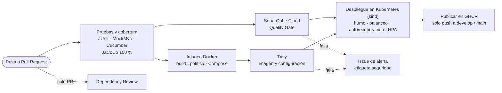

# Recomendaciones — Microservicio de recomendaciones

Microservicio correspondiente al **caso caso03 — StreamVerse** (plataforma de streaming). Se construyó en la Evaluación Parcial N°1 y en la **Evaluación Parcial N°2 de DOY0101** se le agregó un pipeline CI/CD completo en GitHub Actions.

| | |
|---|---|
| Asignaturas | JVY0101 (origen del microservicio) · **DOY0101 Ingeniería DevOps (EP2: pipeline CI/CD)** |
| Stack | Spring Boot 3.5 · Java 21 · Maven · Spring Data JPA · PostgreSQL / H2 · Actuator · springdoc-openapi |
| Calidad | JUnit 5 + MockMvc · Cucumber (BDD) · JaCoCo 100 % de líneas · SonarQube Cloud |
| Seguridad | Dependabot · SonarQube Cloud · Trivy · Dependency Review |
| Entrega | Docker (multi-stage) · Docker Compose · Kubernetes (kind) · GitHub Container Registry |

---

## Pipeline CI/CD

Archivo: [`.github/workflows/ci-cd.yml`](.github/workflows/ci-cd.yml)



### Cuándo se ejecuta cada etapa

| Evento | Pruebas · Sonar · Imagen · Trivy | Despliegue | Entorno | Publicación GHCR |
|---|---|---|---|---|
| Pull Request hacia `develop` o `main` | Sí | Sí, en clúster efímero | `revision` | No |
| Push a `develop` (merge de un PR) | Sí | Sí | `desarrollo` | Sí (`sha-…`, `develop`) |
| Push a `main` (release) | Sí | Sí | `produccion` | Sí (`sha-…`, `main`, `latest`) |

Esto sigue el modelo GitFlow de la EP1: los cambios entran por PR, se prueban y despliegan en revisión, y solo después se integran.

### Etapas del pipeline

| Job | Qué hace | Detiene el pipeline si… | IE |
|---|---|---|---|
| Pruebas y cobertura | `mvn verify`: compila, corre pruebas unitarias, MockMvc y Cucumber, y aplica la regla de cobertura JaCoCo. Publica el reporte de pruebas como *check* y la cobertura en el resumen. | falla una prueba, no hay pruebas o la cobertura de líneas baja de 100 % | IE2 |
| Análisis de código SonarQube Cloud | Análisis estático (bugs, vulnerabilidades, code smells, duplicación, cobertura) y espera el Quality Gate. | el Quality Gate no pasa o falta `SONAR_TOKEN` | IE3 |
| Imagen Docker | Construye la imagen multi-stage con caché, verifica la política de imagen y la prueba levantando app + PostgreSQL con Docker Compose. | la imagen corre como root, no tiene HEALTHCHECK, pesa más de 400 MB, no apunta al commit, o falla la prueba de humo | IE1 |
| Escaneo de seguridad Trivy | Busca CVE en la imagen (sistema y librerías Java) y configuración insegura en Dockerfile y manifiestos de Kubernetes. Sube los hallazgos a la pestaña *Security*. | hay vulnerabilidades HIGH/CRITICAL con parche disponible, o configuración HIGH/CRITICAL | IE3 |
| Revisión de dependencias del PR | Compara las dependencias del PR contra la base de vulnerabilidades de GitHub. | el PR agrega una dependencia con vulnerabilidad alta o crítica | IE3 |
| Grafo de dependencias para Dependabot | Envía el árbol Maven completo (incluye transitivas como Tomcat o Jackson) para que Dependabot alerte sobre todo lo que va en la imagen. | — | IE3 |
| Despliegue en Kubernetes kind | Crea un clúster de 3 nodos, instala metrics-server, despliega con kustomize y verifica la orquestación. | el rollout no termina, falla la prueba de humo, el balanceo o la autorecuperación | IE4 · IE5 |
| Publicar imagen en GHCR | Publica en `ghcr.io` **la misma imagen** que se probó, escaneó y desplegó (mismo digest, sin reconstruir). | — | IE4 |
| Alerta por fallo de seguridad | Si SonarQube o Trivy fallan en `develop`/`main`, abre (o comenta) un issue con etiqueta `seguridad` y enlace a la ejecución. | — | IE3 |

---

## IE1 — Contenedores

[`Dockerfile`](Dockerfile):

- **Multi-stage**: Maven y el JDK quedan en la etapa de compilación; la imagen final usa `eclipse-temurin:21-jre-alpine` (solo JRE).
- **Capas de Spring Boot** (`jarmode=tools extract --layers`): dependencias, cargador y código van en capas separadas. Un cambio de código no vuelve a transferir las dependencias.
- **Caché de Maven** con BuildKit (`--mount=type=cache`) y caché de capas de GitHub Actions (`cache-from/to: type=gha`).
- **Usuario sin privilegios** (UID 10001); los archivos de la app pertenecen a root y son de solo lectura para ese usuario.
- **HEALTHCHECK** contra `/actuator/health/liveness`.
- **JVM ajustada a contenedores**: `-XX:MaxRAMPercentage=50` (heap proporcional al límite de memoria) y `-XX:+ExitOnOutOfMemoryError` (el orquestador reinicia el contenedor en vez de dejarlo degradado).
- **Commit embebido**: el pipeline pasa `GIT_COMMIT` y la app lo publica en `/actuator/info`.
- [`.dockerignore`](.dockerignore) deja fuera todo lo que no sea `pom.xml` y `src/`.

[`docker-compose.yml`](docker-compose.yml) levanta la app con PostgreSQL, healthchecks, límites de CPU/memoria, sistema de archivos de solo lectura y sin capacidades extra. El pipeline lo usa para probar la imagen antes de escanearla.

## IE2 — Pruebas automatizadas

| Prueba | Qué cubre |
|---|---|
| `RecomendacionServiceTest` | Lógica de negocio con Mockito: listar, obtener, crear, actualizar y eliminar (existente e inexistente). |
| `RecomendacionControllerTest` | Contrato HTTP con MockMvc: 200, 201, 204, 400 (validación) y 404 en cada endpoint. |
| `ActuatorEndpointsTest` | Casos críticos de operación: liveness y readiness (los usa Kubernetes), `/actuator/info` con el commit, `health` sin detalles internos y endpoints sensibles cerrados. |
| `OpenApiConfigTest` | Metadatos OpenAPI. |
| Cucumber (`recomendaciones.feature`) | Ciclo completo contra el servidor real en puerto aleatorio: crear → consultar → actualizar → eliminar → 404. |
| `scripts/smoke-test.sh` | Prueba de humo sobre el servicio desplegado (Compose y Kubernetes): salud, CRUD, validación, endpoint sensible cerrado y commit desplegado. |

**Política de calidad** que aplica el pipeline:

1. Todas las pruebas deben pasar y debe existir al menos un reporte de pruebas (`require_tests`).
2. Cobertura de **líneas 100 %** (regla JaCoCo en `pom.xml`, fase `verify`).
3. Quality Gate de SonarQube Cloud en verde (incluye cobertura del código nuevo, duplicación y problemas nuevos).
4. La prueba de humo debe pasar en el contenedor y en Kubernetes antes de publicar la imagen.

Reportes: artefacto `reportes-pruebas` de cada ejecución (Surefire, JaCoCo HTML y Cucumber HTML) y el *check* "Resultados de pruebas" en cada PR.

## IE3 — Seguridad y escalabilidad

### Controles de seguridad

| Control | Dónde | Qué aporta |
|---|---|---|
| Dependabot | [`.github/dependabot.yml`](.github/dependabot.yml) | PR semanales hacia `develop` para Maven, Dockerfile y manifiestos, Docker Compose y GitHub Actions. Cada PR pasa por el pipeline completo. |
| Grafo de dependencias Maven | job `grafo-dependencias` | Dependabot alerta también sobre dependencias transitivas. |
| SonarQube Cloud | job `analisis-codigo` | Análisis estático con Quality Gate bloqueante. |
| Trivy (imagen) | job `escaneo-imagen` | Bloquea CVE HIGH/CRITICAL con parche disponible. |
| Trivy (configuración) | job `escaneo-imagen` | Bloquea configuración insegura en Dockerfile y Kubernetes. |
| Dependency Review | job `revision-dependencias` | Bloquea PR que introducen dependencias vulnerables. |
| Acciones fijadas por SHA | todo el workflow | Una etiqueta (`@v1`) se puede reescribir; un SHA no. En marzo de 2026 se reescribieron etiquetas de `trivy-action` con código malicioso (CVE-2026-33634). |
| Permisos mínimos | `permissions:` por job | El token de cada job solo tiene lo que necesita (por defecto, solo lectura). |
| Secretos fuera del repositorio | `SONAR_TOKEN` en GitHub Secrets; contraseña de PostgreSQL generada por despliegue | Ninguna credencial queda versionada. |
| Pod Security Admission `restricted` | namespaces de `k8s/overlays/*` | Kubernetes rechaza pods que corran como root, escalen privilegios o no usen seccomp. |
| Contenedores endurecidos | `k8s/base/*.yaml` | Sin root, sistema de archivos de solo lectura, sin capacidades, sin token de service account. |
| Superficie mínima | `application.yml` | Actuator solo expone `health` e `info`; consola H2 y SQL en logs desactivados fuera de desarrollo local. |

### Vulnerabilidades corregidas y excepciones

La primera ejecución del pipeline (PR #5) bloqueó el despliegue: Trivy encontró 12 vulnerabilidades HIGH/CRITICAL y SonarQube marcó una posible credencial.

| Hallazgo | Severidad | Acción |
|---|---|---|
| Tomcat 10.1.55 (3 CVE) | CRITICAL | Actualizado a 10.1.59 (`tomcat.version` en `pom.xml`). |
| Jackson 2.21.4 (5 CVE) | HIGH | Actualizado a 2.21.8 (`jackson-bom.version`). |
| Driver PostgreSQL 42.7.11 (CVE-2026-54291) | HIGH | Actualizado a 42.7.14 (`postgresql.version`). |
| brotli-libs de alpine (CVE-2026-111497) | HIGH | `apk upgrade` en la imagen de ejecución. |
| Spring Web MVC 6.2.19 (CVE-2026-47884, CVE-2026-47890) | CRITICAL | **Excepción con vencimiento** en [`.trivyignore.yaml`](.trivyignore.yaml): no hay parche en Spring Framework 6.2 OSS y las fallas requieren `XsltView` y Server-Sent Events, que el servicio no usa. Vence el 2027-01-31; el arreglo definitivo es migrar a Spring Boot 4. |
| `DB_PASSWORD` en el workflow (SonarQube) | — | Marcado como falso positivo en SonarQube: es un valor aleatorio generado en cada ejecución para una base de prueba efímera. |

Las excepciones solo se aplican al paso que bloquea. Los hallazgos siguen visibles en la pestaña *Security* y vuelven a bloquear el pipeline cuando vence la fecha.

### Política de bloqueo y alertas

| Situación | Efecto |
|---|---|
| Quality Gate de SonarQube falla | No se construye el despliegue; se abre issue `seguridad` (en `develop`/`main`). |
| Trivy encuentra CVE HIGH/CRITICAL con parche | No se despliega ni se publica; se abre issue `seguridad`. |
| Trivy encuentra configuración HIGH/CRITICAL | Igual que el anterior. |
| PR agrega dependencia vulnerable (alta/crítica) | El check falla y deja un comentario en el PR. |
| Cualquier job falla | GitHub notifica por correo a quien hizo el push. Con las reglas de rama (ver *Configuración inicial*) el PR no se puede integrar. |

### Parámetros de escalabilidad

| Parámetro | Desarrollo | Producción | Archivo |
|---|---|---|---|
| Réplicas iniciales | 2 | 3 | `deployment.yaml` / overlay |
| HPA (mín – máx) | 2 – 3 | 3 – 6 | `hpa.yaml` / overlay |
| Objetivo de CPU del HPA | 70 % | 70 % | `hpa.yaml` |
| Escalado | sube hasta 2 pods cada 30 s; baja 50 % por minuto tras 2 min estable | igual | `hpa.yaml` |
| CPU por pod (request – limit) | 250m – 1 | 250m – 1 | `deployment.yaml` |
| Memoria por pod (request – limit) | 512Mi – 768Mi | 512Mi – 768Mi | `deployment.yaml` |
| PodDisruptionBudget | mín. 1 disponible | mín. 2 disponibles | `pdb.yaml` / overlay |
| Rolling update | `maxSurge 1`, `maxUnavailable 0` | igual | `deployment.yaml` |

## IE4 — Despliegue automático y trazabilidad

El despliegue corre solo después de que pasan pruebas, SonarQube y Trivy. Se hace en un clúster Kubernetes **kind** (3 nodos) creado dentro del runner, que cumple el rol de nube simulada. El script [`scripts/k8s-deploy.sh`](scripts/k8s-deploy.sh) es el mismo que se usa localmente.

### Cadena de trazabilidad

Cada despliegue se puede seguir desde el commit hasta el pod que atiende las peticiones:

| Eslabón | Cómo queda registrado |
|---|---|
| Commit | SHA de Git, PR asociado y autor. |
| Ejecución del pipeline | Pestaña *Actions*: cada job deja su resumen (pruebas, cobertura, imagen, verificación, trazabilidad). |
| Imagen | Etiqueta `sha-<7 caracteres del commit>` y label OCI `org.opencontainers.image.revision` con el SHA completo. |
| Despliegue en Kubernetes | Anotaciones del Deployment: `kubernetes.io/change-cause` (commit e imagen) y enlace a la ejecución; label `app.kubernetes.io/version`. |
| Aplicación en ejecución | `GET /actuator/info` responde el commit y el pod. El pipeline **verifica** que coincida con el commit que lo disparó. |
| Historial de entornos | Pestaña *Deployments* del repositorio (`revision`, `desarrollo`, `produccion`). |
| Registro de imágenes | `ghcr.io/<owner>/recomendaciones-svc` con el mismo digest que se probó. |
| Evidencia | Artefacto `evidencia-despliegue` (recursos, eventos, historial de rollout y logs), 30 días. |

## IE5 — Orquestación con Kubernetes

```
k8s/
├── base/                      # común a todos los entornos
│   ├── deployment.yaml        # microservicio: réplicas, probes, recursos, seguridad, spread entre nodos
│   ├── service.yaml           # balanceo interno entre réplicas listas
│   ├── hpa.yaml               # autoescalado por CPU
│   ├── pdb.yaml               # disponibilidad mínima durante mantenciones
│   ├── postgres.yaml          # StatefulSet + Service de PostgreSQL con volumen persistente
│   ├── configmap.yaml         # configuración no sensible
│   └── kustomization.yaml
├── overlays/
│   ├── desarrollo/            # namespace recomendaciones-dev
│   └── produccion/            # namespace recomendaciones-prod, más réplicas
└── kind-config.yaml           # clúster local de 3 nodos
```

- **Base de datos compartida**: las réplicas usan un mismo PostgreSQL. Con H2 en memoria cada réplica tendría sus propios datos y el balanceo devolvería resultados distintos.
- **Arranque ordenado**: un *initContainer* espera a PostgreSQL; la *startupProbe* da hasta 150 s para que Spring Boot arranque antes de activar la *livenessProbe*.
- **Tráfico solo a pods sanos**: la *readinessProbe* incluye la conexión a la base de datos.
- **Apagado ordenado**: `server.shutdown=graceful` y `preStop` de 5 s para no cortar peticiones en curso.

Verificaciones automáticas en cada despliegue ([`scripts/k8s-verify.sh`](scripts/k8s-verify.sh) y [`scripts/k8s-carga.sh`](scripts/k8s-carga.sh)):

1. Prueba de humo a través del Service.
2. **Balanceo**: 40 peticiones desde dentro del clúster deben llegar a más de una réplica.
3. **Autorecuperación**: se elimina un pod y Kubernetes debe volver a tener todas las réplicas listas.
4. **Autoescalado** (informativo): se genera carga 90 s y se registra cuántas réplicas levanta el HPA.

---

## Configuración inicial del repositorio (una sola vez)

1. **SonarQube Cloud**
   1. Entrar a [sonarcloud.io](https://sonarcloud.io) con la cuenta de GitHub dueña del repositorio e importar `recomendaciones-svc`.
   2. En el proyecto: *Administration → Analysis Method* → desactivar **Automatic Analysis** (el análisis lo hace el pipeline).
   3. Generar un token en *My Account → Security*.
   4. En GitHub: *Settings → Secrets and variables → Actions* → secreto `SONAR_TOKEN`. Repetir en *Secrets and variables → Dependabot* para que los PR de Dependabot también pasen el análisis.
   5. Si la organización o la clave del proyecto en SonarQube no son `ignacioduoc` / `ignacioduoc_recomendaciones-svc`, ajustar `sonar.organization` y `sonar.projectKey` en `pom.xml`.
2. **Seguridad del código**: *Settings → Advanced Security* (o *Code security*) → activar *Dependency graph*, *Dependabot alerts* y *Dependabot security updates*.
3. **Reglas de rama** (*Settings → Rules → Rulesets*) para `main` y `develop`: exigir Pull Request y que pasen los checks `Pruebas y cobertura (IE2)`, `Análisis de código SonarQube Cloud (IE3)`, `Imagen Docker (IE1)`, `Escaneo de seguridad Trivy (IE3)`, `Revisión de dependencias del PR (IE3)` y `Despliegue en Kubernetes kind (IE4, IE5)`.
4. *(Opcional)* *Settings → Environments → produccion* → *Required reviewers*: el despliegue a producción espera aprobación manual.
5. *(Opcional)* Hacer público el paquete en *Packages → recomendaciones-svc → Package settings*.

No hace falta cambiar los permisos de Actions: cada job declara los permisos que necesita.

## Ejecución local

```bash
# Desarrollo (H2 en memoria)
mvn spring-boot:run                    # http://localhost:8080

# Pruebas y cobertura
mvn verify                             # unitarias + Cucumber + JaCoCo 100 %

# Contenedores: app + PostgreSQL
docker compose up --build -d --wait
./scripts/smoke-test.sh http://localhost:8080
docker compose down -v

# Kubernetes local (requiere kind y kubectl)
kind create cluster --config k8s/kind-config.yaml
docker build -t recomendaciones-svc:local .
kind load docker-image recomendaciones-svc:local postgres:17-alpine --name recomendaciones
./scripts/k8s-deploy.sh desarrollo local
./scripts/k8s-verify.sh recomendaciones-dev
kind delete cluster --name recomendaciones
```

Para ver los endpoints del servicio (`/`, Swagger UI, OpenAPI, ReDoc) ver [`docs/02_API.md`](docs/02_API.md).

## Endpoints

| Método | Ruta | Descripción |
|--------|------|-------------|
| GET | `/api/recomendaciones` | Lista todos los recursos |
| GET | `/api/recomendaciones/{id}` | Obtiene un recurso por id |
| POST | `/api/recomendaciones` | Crea un recurso |
| PUT | `/api/recomendaciones/{id}` | Actualiza un recurso |
| DELETE | `/api/recomendaciones/{id}` | Elimina un recurso |
| GET | `/actuator/health/liveness` · `/readiness` | Salud para Kubernetes |
| GET | `/actuator/info` | Versión, commit desplegado y pod |

## Documentación del proyecto

- [`docs/00_Resumen.md`](docs/00_Resumen.md) — propósito, responsabilidad y tecnologías
- [`docs/01_Arquitectura.md`](docs/01_Arquitectura.md) — componentes, arquitectura y patrones
- [`docs/02_API.md`](docs/02_API.md) — contrato REST y ejemplos curl
- [`docs/03_Pruebas.md`](docs/03_Pruebas.md) — pruebas, cobertura y Cucumber
- [`docs/04_Despliegue.md`](docs/04_Despliegue.md) — despliegue y variables de entorno
- [`docs/05_Justificacion.md`](docs/05_Justificacion.md) — justificación del servicio (EP1)
- [`docs/diagramas/`](docs/diagramas/) — C4, secuencia e infraestructura

---

## Modelo de ramificación

Elegimos GitFlow para este proyecto.

Pensamos también en GitHub Flow y en trunk-based, pero el curso dura todo el semestre y cada entrega se construye sobre la anterior. Por eso nos convenía tener una rama develop separada de main. Así main queda siempre estable, y los cambios se van integrando en develop antes de pasar a producción.

Otra cosa que pesó en la decisión fue poder manejar imprevistos sin frenar el resto del trabajo. Si algo falla en la versión ya entregada, queremos poder corregirlo aparte, sin que eso choque con lo que se está desarrollando en paralelo.

## Buenas prácticas

### Commits

Usamos este formato para los mensajes

    Feat: cuando agregamos algo nuevo
    fix: cuando corregimos algun error
    docs: solo cambios de documentacion
    chore: cambios de configuracion o mantenimiento

Ejemplos:

    docs: agregar changelogs
    fix: corregir typo en readme

### Nombre de las ramas

    Main: Rama de produccion
    develop: Donde se integran los features
    feature: para las nuevas funcionalidades
    hotfix:  para correciones urgentes del main

---

## Decisiones técnicas del equipo (EP2)

> **Pendiente — redactar el equipo, sin IA** (la pauta no permite IA en justificaciones técnicas).
> Explicar con sus palabras por qué eligieron Kubernetes con kind en vez de solo Docker Compose,
> SonarQube Cloud en vez de Snyk, los umbrales de bloqueo (HIGH/CRITICAL, 100 % de líneas),
> los parámetros de escalabilidad de la tabla de IE3 y por qué aceptaron temporalmente las dos
> vulnerabilidades de Spring Web MVC en vez de migrar ahora a Spring Boot 4.

## Uso de Inteligencia Artificial

### EP1

Se utilizó IA (Claude) como apoyo para entender la estructura del proyecto, nos guia en los
comandos de Git y GitHub, y pediamos que nos explicara el funcionamiento de cada línea de código que realizabamos, con el fin de reforzar nuestros conocimientos. Las redacciones finales sobre el README fueron hechas por el equipo.

### EP2

> **Pendiente — revisar y completar el equipo.** Registro de lo que se hizo con apoyo de IA, para que lo
> validen y lo redacten como declaración propia:
>
> - Herramienta: Claude (Anthropic), modelo Claude Opus 5.5, en claude.ai.
> - Se usó para generar una primera versión del workflow de GitHub Actions, el Dockerfile, `docker-compose.yml`,
>   los manifiestos de Kubernetes, los scripts de `scripts/`, la configuración de Dependabot, la prueba
>   `ActuatorEndpointsTest` y la parte descriptiva de este README, incluido el diagrama del pipeline.
> - Todo el contenido debe ser revisado, ejecutado y validado por el equipo (ver la pestaña *Actions*).
> - Formato de cita sugerido por [bibliotecas.duoc.cl/ia](https://bibliotecas.duoc.cl/ia):
>   Anthropic. (2026). *Claude Opus 5.5* [Modelo de lenguaje de gran tamaño]. <https://claude.ai>

## Reflexiones

### EP1 — Felipe Veliz

En este trabajo logre comprender mas las funcionalidades de git y aprender un poco mas de los comandos basicos como  un git commit  guardar los cambios con git push y unir las ramas con git merge antes la usaba sin saber para que servian pero con este trabajo pude entender del porque el uso de ellas

### EP1 — Ignacio Gonzalez

Durante el proyecto logré comprender mejor las funcionalidades de git y los diferentes tipos de comandos, los cuales fuimos profundizando y, a su vez, aprendiendo para qué sirven. Esto también sirvió para empezar a trabajar en equipo y tener una mejor comunicación al respecto. Tuve varios errores de sintaxis, pero se fueron corrigiendo mediante la práctica que conllevaba el trabajo. En lo personal, entender la diferencia entre las distintas ramas que hay, como por ejemplo develop y las ramas feature, fue lo que más trabajo me costó al principio de entender.

### EP2 — Felipe Veliz

> **Pendiente — reflexión personal, redactada sin IA** (aprendizaje y contribución al proyecto).

### EP2 — Ignacio Gonzalez

> **Pendiente — reflexión personal, redactada sin IA** (aprendizaje y contribución al proyecto).
