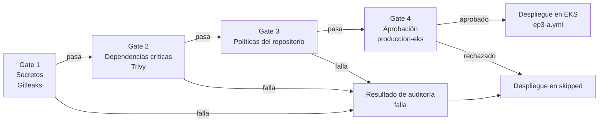

# Freno automático del pipeline (EP3 · IE6)

Documenta cómo el pipeline se detiene solo cuando no se cumple una política, y cómo se demuestra.

| | |
|---|---|
| Workflow | [`.github/workflows/ep3-b.yml`](../.github/workflows/ep3-b.yml) |
| Despliegue que se frena | `Despliegue en EKS (IE2)` de [`.github/workflows/ep3-a.yml`](../.github/workflows/ep3-a.yml) |
| Check requerido | `Resultado de auditoría (IE5, IE6)` |
| Environment de aprobación | `produccion-eks` |
| Responsable | Felipe Veliz |

## Cadena de gates



Los jobs se encadenan con `needs:`. Si un gate termina con código distinto de 0, GitHub marca en *skipped* todo lo que depende de él:

| Si falla… | Quedan en *skipped* | Resultado de auditoría | Despliegue en EKS |
|---|---|---|---|
| Secretos | Dependencias, Políticas, Aprobación | ❌ | *skipped* |
| Dependencias críticas | Políticas, Aprobación | ❌ | *skipped* |
| Políticas | Aprobación | ❌ | *skipped* |
| Aprobación (rechazada) | — | ✅ | *skipped* |

En un Pull Request, además, el ruleset no deja integrar mientras `Resultado de auditoría (IE5, IE6)` esté en rojo.

## Por qué el check requerido es `Resultado de auditoría`

GitHub cuenta un job en *skipped* como exitoso. Si el ruleset exigiera solo `Auditoría · Políticas del repositorio (IE5)` y fallara el primer gate, Políticas quedaría en *skipped* y el PR se podría integrar.

Por eso el job `Resultado de auditoría (IE5, IE6)` corre siempre (`if: always()`), revisa el resultado de los tres gates y falla en el paso **Freno del pipeline** si alguno no terminó en `success`. Ese es el único check de `ep3-b.yml` que hay que exigir en el ruleset.

## Aprobación de producción

Configuración, una sola vez, en *Settings → Environments → New environment* (requiere permisos de administrador del repositorio):

1. Nombre: `produccion-eks`.
2. **Required reviewers:** `velizntd` e `ignacioduoc`.
3. Marcar **Prevent self-review**, para que apruebe quien no disparó el despliegue.
4. **Deployment branches and tags:** *Selected branches* → `develop`.

Cuando `ep3-a.yml` llama a la auditoría con `aprobacion-produccion: true`, la ejecución se detiene en `Aprobación para producción (IE6)` hasta que el revisor pulse *Review deployments*. Si lo aprueba, sigue el despliegue; si lo rechaza, el job falla y el despliegue queda en *skipped*. Quién aprobó queda registrado en la ejecución y en la pestaña *Deployments*.

## Conexión con `ep3-a.yml`

`ep3-b.yml` es un workflow reutilizable (`workflow_call`). `ep3-a.yml` lo llama como un job más y hace que el despliegue dependa de él:

```yaml
jobs:
  auditoria:
    name: Auditoría y freno (IE5, IE6)
    uses: ./.github/workflows/ep3-b.yml
    permissions:
      contents: read
      security-events: write   # el gate de dependencias sube su reporte a la pestaña Security
    with:
      aprobacion-produccion: true

  despliegue-eks:
    name: Despliegue en EKS (IE2)
    needs: auditoria
    # ... el resto del job queda igual
```

Los `permissions:` del job `auditoria` son obligatorios: un workflow llamado no puede pedir más permisos que los que le da quien lo llama, y sin `security-events: write` GitHub rechaza la ejecución completa.

## Ruleset `proteccion-main-develop`

En *Settings → Rules → Rulesets → proteccion-main-develop → Require status checks to pass*, agregar `Resultado de auditoría (IE5, IE6)`. El check aparece en la lista después de que `ep3-b.yml` haya corrido una vez en un PR.

## Demostración del freno

Las demostraciones se hacen en ramas `demo/...` que nunca se integran. Antes de empezar, `ep3-a.yml` ya debe llamar a la auditoría y el ruleset debe exigir el check.

### Demo 1: secreto en el código

```bash
git checkout develop && git pull
git checkout -b demo/ep3-secreto-falso

# Token falso, generado en el momento: no da acceso a nada, pero tiene la forma de una clave
printf 'demo.api.token=Dm0%s\n' "$(openssl rand -base64 32 | tr -dc 'A-Za-z0-9' | head -c 21)" \
  > src/main/resources/application-demo.properties

git add src/main/resources/application-demo.properties
git commit -m "test(ep3): agrega un token falso para demostrar el freno del pipeline"
git push -u origin demo/ep3-secreto-falso
```

1. Abrir un PR de `demo/ep3-secreto-falso` hacia `develop`, sin integrarlo.
2. En el PR: `Auditoría · Secretos (IE5)` en rojo, Dependencias y Políticas en *skipped*, `Resultado de auditoría (IE5, IE6)` en rojo y el botón de merge bloqueado. En *Files changed*, la anotación aparece sobre la línea del token.
3. En *Actions → EP3-A Despliegue en EKS → Run workflow*, elegir la rama `demo/ep3-secreto-falso`. La auditoría falla y `Despliegue en EKS (IE2)` queda en *skipped*.
4. Cerrar el PR sin integrar y borrar la rama:

```bash
git checkout develop
git push origin --delete demo/ep3-secreto-falso
git branch -D demo/ep3-secreto-falso
```

### Demo 2 (opcional): dependencia con CVE crítico

Igual que la demo 1, en la rama `demo/ep3-dependencia-critica`, agregando dentro de `<dependencies>` del `pom.xml` una versión de Log4j afectada por Log4Shell (CVE-2021-44228, CRITICAL):

```xml
<dependency>
    <groupId>org.apache.logging.log4j</groupId>
    <artifactId>log4j-core</artifactId>
    <version>2.14.1</version>
</dependency>
```

Esta vez Secretos pasa, `Auditoría · Dependencias críticas (IE5)` falla con el CVE en la anotación y Políticas queda en *skipped*. Así se ve que la cadena se corta en el gate que falla, no siempre en el primero.

### Demo 3: aprobación de producción

Con un push normal a `develop`, la ejecución de `ep3-a.yml` queda esperando en `Aprobación para producción (IE6)`. Capturar la espera y el diálogo *Review deployments*, y aprobar desde la cuenta del otro integrante.

## Evidencias

Capturas en [`docs/evidencias/`](evidencias/):

| Archivo | Qué muestra |
|---|---|
| `freno-secreto-detectado.png` | Checks del PR de la demo 1: Secretos en rojo y el resto en *skipped* |
| `freno-anotacion-secreto.png` | Anotación de Gitleaks sobre la línea del token en *Files changed* |
| `freno-merge-bloqueado.png` | Botón de merge bloqueado por `Resultado de auditoría (IE5, IE6)` |
| `freno-despliegue-skipped.png` | Grafo de la ejecución de `ep3-a.yml` con la auditoría en rojo y el despliegue en *skipped* |
| `freno-dependencia-critica.png` | Demo 2: Dependencias en rojo y Políticas en *skipped* |
| `freno-aprobacion-pendiente.png` | Demo 3: despliegue esperando la aprobación de `produccion-eks` |
| `freno-environment-revisores.png` | Configuración del environment `produccion-eks` con revisores requeridos |

## Justificación técnica

> **Pendiente:** la escribe Felipe, sin IA.
