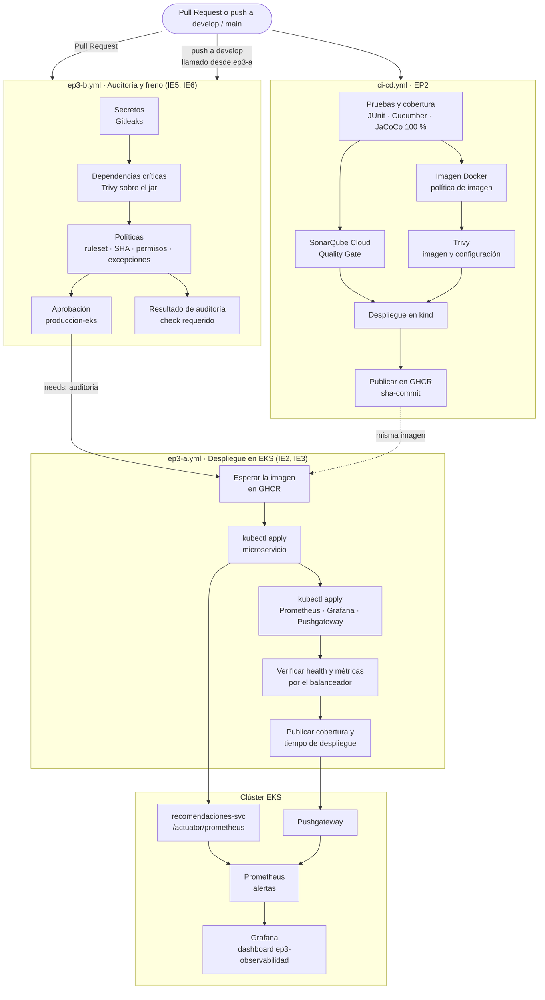

# Mapa del pipeline y uso de la observabilidad (EP3 · IE4)

Documenta el pipeline completo (EP2 + EP3), qué hace cada herramienta y cómo los paneles de Grafana llevan a una decisión técnica.

| Workflow | Parte | Se dispara con |
|---|---|---|
| [`ci-cd.yml`](../.github/workflows/ci-cd.yml) | EP2: pruebas, calidad, imagen, seguridad, despliegue en kind y publicación en GHCR | Push y PR hacia `develop` o `main` |
| [`ep3-b.yml`](../.github/workflows/ep3-b.yml) | EP3-B: auditoría de cumplimiento y freno (IE5, IE6) | PR hacia `develop` o `main`, y llamado desde `ep3-a.yml` |
| [`ep3-a.yml`](../.github/workflows/ep3-a.yml) | EP3-A: despliegue en EKS y métricas del pipeline (IE2, IE3) | Push a `develop` |

## Mapa del pipeline

En un Pull Request corren `ci-cd.yml` y `ep3-b.yml`, y el ruleset exige los checks de ambos. En un push a `develop`, `ep3-a.yml` llama primero a `ep3-b.yml`; solo si la auditoría y la aprobación pasan, espera la imagen que publicó `ci-cd.yml` y la despliega en EKS.

## Qué hace cada herramienta

| Etapa | Herramienta | Dónde está | Qué hace | ¿Detiene el pipeline? |
|---|---|---|---|---|
| Pruebas | JUnit 5, MockMvc, Cucumber, JaCoCo | `ci-cd.yml`, `pom.xml` | Pruebas unitarias, de contrato HTTP y BDD; exige 100 % de cobertura de líneas | Sí |
| Calidad | SonarQube Cloud | `ci-cd.yml`, `pom.xml` | Análisis estático con Quality Gate | Sí |
| Contenedor | Docker (multi-stage) | `Dockerfile`, `ci-cd.yml` | Construye la imagen y verifica usuario, HEALTHCHECK, tamaño y commit | Sí |
| Seguridad de la imagen | Trivy | `ci-cd.yml` | CVE HIGH/CRITICAL con parche en la imagen y configuración insegura en Dockerfile y Kubernetes | Sí |
| Dependencias del PR | Dependency Review | `ci-cd.yml` | Rechaza dependencias nuevas con vulnerabilidad alta o crítica | Sí |
| Actualizaciones | Dependabot | `.github/dependabot.yml` | PR semanales para Maven, imágenes y acciones | No |
| Secretos | Gitleaks | `ep3-b.yml`, `.gitleaks.toml` | Busca credenciales en los commits | Sí |
| Dependencias del jar | Trivy | `ep3-b.yml` | CVE CRITICAL en las librerías que van dentro del jar | Sí |
| Políticas | `audit/auditoria.sh` + API de GitHub | `ep3-b.yml` | Ramas protegidas, acciones por SHA, permisos, excepciones con vencimiento, archivos sensibles | Sí |
| Aprobación | GitHub Environments | `ep3-b.yml` | Un revisor aprueba el despliegue en EKS | Sí |
| Orquestación de prueba | kind | `ci-cd.yml`, `k8s/` | Clúster efímero para probar el despliegue en cada PR | Sí |
| Nube | Amazon EKS, kubectl, kustomize | `ep3-a.yml`, `k8s/overlays/eks` | Despliegue real con balanceador público | Sí |
| Métricas de la app | Spring Boot Actuator + Micrometer | `application.yml` | Expone `/actuator/prometheus` | — |
| Monitoreo | Prometheus | `k8s/observabilidad/prometheus` | Recolecta métricas cada 15 s y evalúa alertas | — |
| Métricas del pipeline | Pushgateway | `k8s/observabilidad/pushgateway`, `ep3-a.yml` | Recibe cobertura y tiempo de despliegue desde el pipeline | — |
| Dashboard | Grafana | `k8s/observabilidad/grafana` | Dashboard `ep3-observabilidad` versionado como JSON | — |
| Registro de imágenes | GitHub Container Registry | `ci-cd.yml` | Guarda la imagen probada con la etiqueta `sha-<commit>` | — |

## Por qué elegimos cada herramienta

> **Pendiente:** la escribe Felipe, sin IA. Herramientas a justificar: Gitleaks, Trivy sobre el jar, el script de auditoría con la API de rulesets, GitHub Environments para la aprobación y el workflow reutilizable para conectar la auditoría con el despliegue.

## Panel → decisión → acción

Umbrales tomados del dashboard [`ep3-observabilidad.json`](../k8s/observabilidad/grafana/dashboards/ep3-observabilidad.json) y de las alertas de [`alertas.yml`](../k8s/observabilidad/prometheus/alertas.yml). Los comandos `kubectl` de esta tabla solo leen el estado del clúster: cualquier cambio se hace con un PR y lo aplica el pipeline.

| Panel | Métrica | Umbral | Decisión | Acción |
|---|---|---|---|---|
| Pods del servicio arriba | `sum(up{job="recomendaciones-svc"})` | Verde con 2 o más, amarillo con 1, rojo con 0. Alerta `ServicioCaido` si `up == 0` durante 1 minuto | Con 1 pod se perdió la alta disponibilidad; con 0 el servicio está caído | `kubectl -n recomendaciones-eks get pods` y `kubectl describe pod` para ver el motivo (probe, OOMKilled, imagen). Si empezó con el último despliegue, revertir el merge con `git revert` en un PR: el pipeline despliega la versión anterior |
| Errores 5xx por segundo | `sum(rate(http_server_requests_seconds_count{application="recomendaciones-svc", status=~"5.."}[5m]))` | Rojo sobre 0,05 por segundo. Alerta `ErroresServidorAltos` si pasan del 5 % durante 5 minutos | Si subió justo después de un despliegue, la causa más probable es el cambio; si no, una dependencia como PostgreSQL | `kubectl -n recomendaciones-eks logs -l app.kubernetes.io/name=recomendaciones-svc` y revisar la hora del último despliegue en *Deployments*. Si coincide, revertir con un PR |
| Peticiones por segundo según estado | `sum by (status) (rate(http_server_requests_seconds_count[5m]))` | Sin umbral | Un alza de 4xx apunta a quien llama a la API (contrato o validación), no a una falla del servicio | Ver qué endpoint responde 4xx y contrastarlo con [`02_API.md`](02_API.md) |
| Uso de CPU por contenedor | `rate(container_cpu_usage_seconds_total[2m])` (cAdvisor) | Request de 250m y límite de 1 CPU. El HPA escala sobre el 70 % del request, de 2 a 4 réplicas | Si la CPU sigue alta con 4 réplicas, el HPA llegó a su máximo | Subir `maxReplicas` en `k8s/base/hpa.yaml` o los recursos en `deployment.yaml`, con un PR |
| Uso de memoria por contenedor | `container_memory_working_set_bytes` (cAdvisor) | Límite de 768 Mi. Alerta `MemoriaHeapAlta` si el heap pasa del 85 % durante 5 minutos | Cerca del límite, Kubernetes reinicia el pod por OOMKilled | Revisar reinicios con `kubectl get pods`. Ajustar el límite en `deployment.yaml` o `MaxRAMPercentage` (hoy 50 %) en el `Dockerfile`, con un PR |
| Cobertura de pruebas (líneas) | `ci_cobertura_lineas_percent` | Verde con 100 %, amarillo desde 90 %, rojo bajo 90 % | `ci-cd.yml` exige 100 %, así que lo desplegado siempre debería marcar 100 % | Si marca menos, alguien cambió la regla de JaCoCo: buscar en el historial de `pom.xml` el PR que la cambió |
| Tiempo del último despliegue | `ci_despliegue_duracion_segundos` | Verde bajo 300 s, amarillo hasta 600 s, rojo sobre 600 s | Un alza indica que un paso del despliegue se volvió lento | Abrir la ejecución de `ep3-a.yml` y ver qué paso tardó más (rollout, balanceador, Pushgateway). Revisar eventos con `kubectl -n recomendaciones-eks get events` |

## Dónde ver cada evidencia en GitHub

| Qué | Dónde |
|---|---|
| Resultado de cada gate | Pestaña *Actions*, grafo de jobs de cada ejecución |
| Reporte de auditoría | Resumen del job `Resultado de auditoría (IE5, IE6)` y artefacto `reporte-auditoria` |
| Hallazgos de seguridad | Pestaña *Security* (Trivy, Dependabot) |
| Historial de despliegues y aprobaciones | Pestaña *Deployments* y environments `eks` y `produccion-eks` |
| Reglas de las ramas | *Settings → Rules → Rulesets → proteccion-main-develop* |
| Métricas del servicio y del pipeline | Dashboard `ep3-observabilidad` en Grafana |
